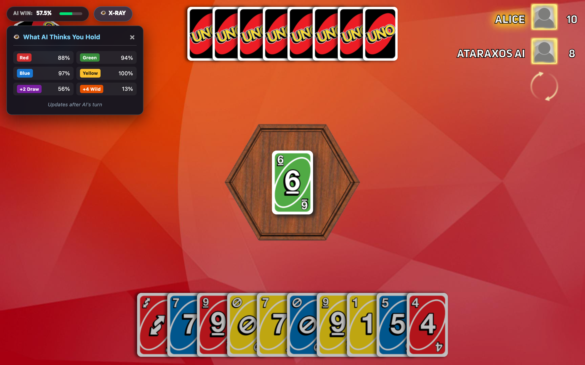

# Ataraxos-UNO

**An imperfect-information RL agent and risk-averse search engine for 1v1 UNO — running 100% client-side via ONNX Runtime Web (WebGPU/WASM).**

<p align="center">
  <a href="https://tanishkbansode.github.io/uno-ataraxos/">
    
  </a>
  
  
  
</p>

<p align="center">
  
</p>

> **[Play 1v1 against Ataraxos-UNO in your browser →](https://tanishkbansode.github.io/uno-ataraxos/)**  
> Toggle **👁 X-RAY** during a match to inspect the real-time probability distribution the AI infers over your hidden cards.

---

## Overview

Ataraxos-UNO is a deep reinforcement learning and test-time search system for two-player competitive UNO with same-type draw stacking ([`docs/RULES.md`](docs/RULES.md)).

The agent pairs a 100M-step self-play blueprint with an autoregressive belief network and **risk-averse portfolio search** (evaluating candidate moves against conservative, soft-minimax weighted opponent styles), achieving a **66.0% win rate against hand-crafted expert heuristic bots** in duplicate tournaments.

Unlike standard web demos that only execute passive neural forward passes, Ataraxos-UNO runs the **entire test-time search loop**—including exact reshuffle provenance tracking, belief world sampling, and 192 parallel rollouts—**100% client-side in the browser** with bit-for-bit parity against the C++ training engine, requiring zero backend servers or external API dependencies.

- **Compute Efficiency:** The full 100M-step self-play blueprint (~2.45M complete games) trains in **~3.5 hours on a single CUDA GPU** or **~5 hours on Apple Silicon MPS**, powered by the 7.8M SPS C++ vectorized simulator (`VecUnoEnv`).
- **Solving Rollout Overfitting:** Naive single-policy search assumed opponents would hoard Wilds and respect stack counters like the equilibrium blueprint, making it fragile against aggressive heuristic play. Ataraxos-UNO solves this via a **3-style opponent portfolio rollout** (Blueprint, Aggressive, Unpredictable) with entropic soft-minimax aggregation ($\gamma = 4.0$), turning a net loss into a **+5.0% boost against Expert heuristics** ([ablation details →](docs/RESEARCH.md#6-solving-rollout-overfitting-2400-game-controlled-ablation)).

---

## Motivation: From Stratego to UNO

The architecture is inspired by the **Ataraxos** framework ([Sokota et al., *Nature* 658, 55–59, 2026](https://www.nature.com/articles/s41586-026-11036-y)), which achieved superhuman play in **Stratego** — a landmark game of imperfect and incomplete information where piece ranks remain hidden until engagement. 

Ataraxos showed that regularized equilibrium self-play, combined with generative belief modeling and **update-equivalence search** (evaluating candidate moves across sampled hidden states, then applying a self-play policy improvement step to refine the local decision), can master complex hidden-information games without human domain knowledge.

This sparked a question: *Can we adapt these principles for **UNO**?*

While casual UNO is viewed as a party game, 1v1 tournament UNO with same-type stacking is a mathematically challenging **imperfect-information game**:
- **Information Asymmetry:** Players observe only their hand, the discard pile, and public move history; the opponent's hand and deck remain hidden.
- **Reshuffle Provenance:** Tracking recycled discard pools during deck exhaustion yields exact mathematical bounds on the opponent's draw pool.
- **Extra-Turn Combos:** With `Reverse = Skip` in 1v1, 16 extra-turn cards allow shedding multiple cards in a single uninterrupted turn.
- **Strategic Voluntary Drawing:** Players may deliberately draw while holding legal cards to hoard Wilds and `+4`s for the endgame.

Ataraxos-UNO adapts these principles to UNO using a 7.8M SPS C++ vectorized environment, an autoregressive belief network, Variance-Reduced Policy Optimization (VRPO Expected SARSA(λ); Fan & Farina, 2026), Exponential Moving Average magnet regularization (EMAgnet; Maidment et al., 2026), and risk-averse portfolio search (detailed with derivations in [`docs/RESEARCH.md`](docs/RESEARCH.md)).

---

## Benchmark Results

### Playing Strength

Evaluated using **mirrored duplicate decks** (each shuffled 108-card deck is played twice with swapped seats) to cancel out first-order deal luck.

| Matchup | 100M Blueprint | + Portfolio Search | Evaluation Setup |
| :--- | :---: | :---: | :--- |
| **vs. Expert Heuristic** | 61.0% | **66.0% (132–68)** | 100 duplicate decks (200 games) |
| **3-Opponent Suite Avg.** | 55.3% | **58.3% (+3.0%)** | 600 duplicate games (200 each vs. Blueprint, Expert, Exploiter; 2,400 across ablation suite) |

- **Baseline (`ExpertHeuristicBot`):** Hand-crafted tournament heuristic that counters `+2`/`+4` stacks into its most abundant color, chains Skips/Reverses for tempo, saves Wilds as finishers, and drops penalties when the opponent has ≤ 3 cards.
- **Emergent Strategy:** Without reward shaping, the self-play policy independently learned to draw voluntarily **12.45%** of the time—with **93.9%** of those draws hoarding Wilds or stack counters for the endgame.

### Engine & Runtime Performance

- **C++17 Simulator:** **7.8M steps/sec** across 512 parallel environments (10 threads, Apple Silicon, `-O3`) — ~1,850× faster than Python `uno-gym` (~4.2k steps/sec).
- **In-Browser Move Latency:** **~40–120 ms/move** on WebGPU (192 search worlds) and **~150–250 ms/move** on WASM CPU fallback (48 worlds).
- **Single Forward Pass:** **< 1 ms** on WebGPU (**~8 ms** on WASM SIMD) for the Actor policy + value head (`batch = 1`).
- **Belief Calibration:** **+1.19 nats/hand** log-likelihood gain over an analytical hypergeometric prior (50,048 validation positions).
- **Export Parity:** **100/100** argmax match between PyTorch FP32 and exported ONNX models (max output diff `< 1.97e-6`).

---

## Card Variance & Limitations

In perfect-information games like Chess, a superhuman engine will win ~100% of matches because every piece is visible. In UNO, **a 100% win rate is mathematically impossible**:

- **Deal Stochasticity:** If a player is dealt seven disconnected number cards and the opponent is dealt two `Skip`s and two `+4`s, optimal game theory cannot rewrite the deal. An unwinnable opening hand is unwinnable. In a single casual game, variance dominates; over a 50-game duplicate match, the AI's card counting, voluntary hoarding, and risk-averse portfolio search reliably prevail.
- **Current Technical Limitations:**
  - **1v1 Scope Only:** The engine strictly models heads-up play and does not support 3–4 player table dynamics, turn reversal rings, or multi-agent kingmaking.
  - **Static Portfolio Rollouts:** The client-side search uses a fixed 3-style rollout distribution (Blueprint, Aggressive, Noisy) rather than online Bayesian parameter updates.
  - **Compute Budgets in Browser:** In-browser search is capped at 192 worlds on WebGPU and 48 worlds on WASM to maintain responsive interactive play under 150 ms on WebGPU (~250 ms on WASM).

---

## Quickstart

### 1. Play in Browser (Zero Setup)
Open **[https://tanishkbansode.github.io/uno-ataraxos/](https://tanishkbansode.github.io/uno-ataraxos/)** in any modern web browser. The ~26 MB ONNX models download once, cache locally in IndexedDB, and run client-side on WebGPU/WASM with zero server dependencies.

---

### 2. Run Locally in Browser (Zero Checkpoints Needed)
Clone the repository and serve the web interface locally using the bundled ONNX models (`web/model/*.onnx`):

```bash
git clone https://github.com/TanishkBansode/uno-ataraxos.git
cd uno-ataraxos

# Using Python's built-in HTTP server
python3 -m http.server 8000 --directory web

# Or using Node.js
npx serve web
```
Open <http://localhost:8000>. The web interface runs on your local GPU or WASM runtime without requiring Python dependencies or PyTorch.

---

### 3. Run Python Daemon & CLI (Requires C++17 Compiler)
To run the native C++ vectorized environment, training loops, or server-side PyTorch search daemon:

```bash
# Prerequisites: Python 3.9+ and a C++17 compiler (GCC >= 9, Clang >= 11, or Apple Clang)
pip install -e .

# Option A: Launch local server (serves web/ with bundled ONNX models out of the box)
python scripts/serve.py

# Option B: Play in terminal with live Belief X-Ray (requires trained .pt checkpoints)
python scripts/play.py --blueprint runs/blueprint_100m/latest.pt --belief runs/belief_20m/best.pt --xray
```

> **Note on Checkpoints:** Fresh git clones do not include raw PyTorch checkpoints (`*.pt`), which are excluded by `.gitignore`. `scripts/serve.py` automatically serves the static web UI with the bundled ONNX models out of the box. To download pre-trained PyTorch checkpoints for terminal play and training pipelines, run `python scripts/download_checkpoints.py` or download from [**GitHub Releases (v1.0.0)**](https://github.com/TanishkBansode/uno-ataraxos/releases/tag/v1.0.0). To train your own checkpoints from scratch, see [**`docs/TRAINING.md`**](docs/TRAINING.md).

---

### 4. Run Test Suite
```bash
pytest tests/ -q                           # 72 Python + C++ unit, parity, RL & API tests
node tests/test_js_features_parity.mjs     # 4,000-step JS vs C++ feature parity
node tests/test_fast_rollout_parity.mjs    # 4,000-step JS vs C++ rollout parity
```

---

## Documentation

- **[`docs/RESEARCH.md`](docs/RESEARCH.md)**: Technical whitepaper detailing the 4-stage neural architecture, VRPO Expected SARSA(λ), EMAgnet regularization, the 2,400-game ablation matrix, and academic citations.
- **[`docs/TRAINING.md`](docs/TRAINING.md)**: Hardware matrix (NVIDIA CUDA, Apple Silicon MPS, CPU) and end-to-end training instructions for Blueprint, Belief Net, and Neural Exploiter.
- **[`docs/RULES.md`](docs/RULES.md)**: 108-card 1v1 competitive UNO rules specification (with same-type draw stacking).
- **[`web/README.md`](web/README.md)**: Frontend architecture guide detailing client-side in-browser vs. Python daemon execution, ONNX exports, and WebGPU configuration.

---

## Repository Structure

```text
uno-ataraxos/
├── cpp/                         # C++17 multi-threaded VecUnoEnv (7.8M SPS) + pybind11 bindings
├── uno_ataraxos/                # Neural networks, RL math, belief modeling, and search solver
├── web/                         # Static WebGPU/WASM web app deployed to GitHub Pages
├── scripts/                     # train.py, serve.py, play.py, export_onnx.py, tune_search.py
├── tests/                       # 72 pytest tests + JS/C++ bit-for-bit parity tests
└── docs/
    ├── RESEARCH.md              # Research paper, ablation studies, and math formulation
    ├── RULES.md                 # 108-card 1v1 UNO rules specification
    ├── TRAINING.md              # Cross-platform training guide
    └── demo_gameplay.png        # Live gameplay visual asset
```

---

## License

MIT License — see [`LICENSE`](LICENSE).
